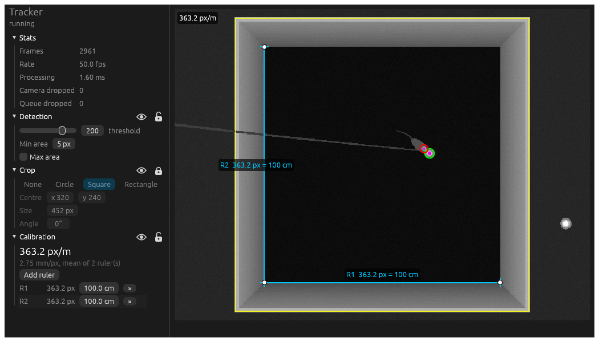

# Open Ephys (v1) Plugin - Camera

An Open Ephys source plugin that tracks an animal's head LEDs from an overhead camera and records their
positions as continuous channels alongside your ephys data. It's inspired by the kind of pipeline you'd
build in [Bonsai](https://bonsai-rx.org/), but it's a small, opinionated tracker written in Rust and runs
inside Open Ephys, with its own live-view window.



## What it does

Each camera frame goes through: **crop → threshold → connected regions → two largest regions**. The
centroids and areas of those two regions (normally the big and small headstage LEDs) become one sample.

| Channel | Contents |
|---|---|
| `BONS1` | camera timestamp, seconds since the first frame |
| `BONS2`, `BONS3` | x, y of the largest region (pixels) |
| `BONS4`, `BONS5` | x, y of the second largest region |
| `BONS6`, `BONS7` | areas of the two regions (pixels) |

A missing region gives NaN coordinates and zero area. The channel names are kept from earlier versions of this
plugin so existing analysis code keeps working.

While acquisition runs, a tracker window shows the live video with:

- **Detection**: brightness threshold and min/max region area. The eye highlights above-threshold pixels
  and circles the two detected regions.
- **Crop**: none, circle, square or rectangle. Drag to move, use the handles to resize, and use the stalk to
  rotate (shift snaps to 15°). The eye shows the whole frame with the crop outline, or hides it and masks
  out everything outside the crop.
- **Calibration**: rulers you drag onto things of known size and give a length in cm. The mean pixels per
  metre is shown in the panel and over the video, even while the rulers are hidden.
- Stats: frame rate, processing time, dropped frames.

The eye and padlock sit in each section's header. The padlock locks that section's controls and stops its
overlay being dragged on the video.

These settings are saved with the Open Ephys signal chain.

> **macOS:** the tracker window can't open inside Open Ephys on macOS (only the main thread can create
> windows there, and Open Ephys owns it), so the plugin runs without one. Use `tracker-dev` (below) to
> see the window. Windows and Linux are fine.

### Cameras

For now there's a fake camera (`tools/fake_camera.py`, streaming over TCP) and a built-in synthetic one.
Support for real cameras is next; see [PLAN.md](PLAN.md).

### Timestamps and sample quality

The plugin "smooths" samples onto the sample rate set in the editor, using the camera's timestamps
relative to the first frame. A sample more than half a period early is dropped; if a sample is more than
half a period late, the gap is filled with NaN samples. The editor's quality widget shows the last 10
seconds: green for samples used (a full bar means on time, shorter bars mean slightly early or late),
white for gap-filled samples, and red for dropped ones. This reflects the camera's timestamps, not
arrival times, so it gives internal consistency rather than precise alignment with other data sources.

The timestamp channel is a 32-bit float, which holds about three decimal places up to ~5 hours. Restart
acquisition at least that often.

## Installing

The plugin isn't part of the official Open Ephys set. Windows builds come from GitHub Actions:

- **Branches / pull requests:** open the workflow run and download the `open-ephys-plugin-camera` artifact.
- **master:** each push also creates a [release](https://github.com/d1manson/open-ephys-plugin-bonsai/releases).

Copy `open-ephys-plugin-camera.dll` into `C:\Program Files\Open Ephys\plugins` and add the **Camera**
source to your signal chain.

## Development

You need CMake, a C++ toolchain, the [Open Ephys GUI source](https://github.com/open-ephys/plugin-GUI)
(built first), and Rust via [rustup](https://rustup.rs). CMake fetches
[Corrosion](https://github.com/corrosion-rs/corrosion) to build the Rust library.

```
Source/          C++ plugin: DataThread, editor, sample smoothing (SampleWriter)
tracker/         Rust library: cameras, pipeline, window (egui), C API (include/tracker.h)
tools/           fake_camera.py: a fake overhead camera over a 1x1 m arena with a mouse
PLAN.md          architecture and roadmap
```

### Without Open Ephys

```bash
python3 tools/fake_camera.py                      # fake camera on 127.0.0.1:27030 (standard library only)
cd tracker
cargo run --release --bin tracker-dev             # the tracker window, printing samples to stdout
cargo run --release --bin tracker-dev -- synthetic   # or without the fake camera
cargo test --release -- --include-ignored         # tests, incl. end-to-end against fake_camera.py
```

The window tests compare against images in `tracker/tests/snapshots/`. Run with `UPDATE_SNAPSHOTS=1` to
accept intended changes. `cargo test --release readme_screenshot -- --ignored` regenerates
`docs/screenshot.png`.

### Building the plugin on macOS

```bash
# in the Open Ephys GUI's Build dir, first
cmake -G Xcode ..

# then in this repo's Build dir (set GUI_BASE_DIR to your GUI checkout)
GUI_BASE_DIR=../../plugin-GUI cmake -G Xcode ..
cmake --build . --config Release
cp -R Release/open-ephys-plugin-camera.bundle ~/Library/Application\ Support/open-ephys/plugins-api10/
```

macOS builds are for the host architecture only (Corrosion can't build universal binaries).

### Building on Windows

See [.github/workflows/windows.yml](.github/workflows/windows.yml) for the exact steps CI uses.
